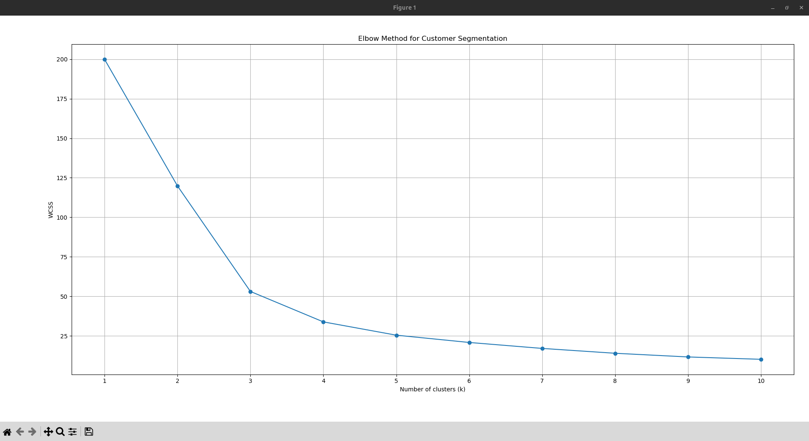
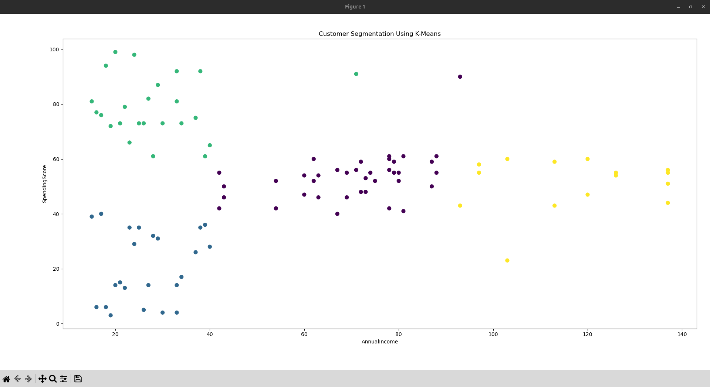

# Customer Segmentation Using K-Means

## Overview

This project uses the K-Means clustering algorithm to group mall customers based on their annual income and spending score.

Customer segmentation can help businesses identify different spending patterns and understand customer groups.

## Technologies Used

- Python
- Pandas
- Matplotlib
- Scikit-learn
- K-Means Clustering

## Project Workflow

1. Load the customer dataset from CSV.
2. Perform basic exploratory data analysis (EDA).
3. Select annual income and spending score as features.
4. Standardize the selected features using StandardScaler.
5. Apply the Elbow Method to examine suitable cluster counts.
6. Train a K-Means clustering model.
7. Visualize customer segments.
8. Export the dataset with cluster labels.

## Installation

Clone the repository and navigate to this project directory.

Install the required packages:

```bash
pip install -r requirements.txt
```

## Dataset

Place `Mall_Customers.csv` in the project directory before running the program.

The dataset should contain annual income and spending score columns.

## Run the Project

```bash
python3 customer_segmentation.py
```

The program displays the Elbow Method graph and customer segmentation visualization.

It also generates `customer_segments.csv`, which contains the assigned cluster labels.

## Algorithm

K-Means groups observations into a specified number of clusters by iteratively assigning data points to clusters and updating their centroids.

The Elbow Method plots Within-Cluster Sum of Squares (WCSS) against the number of clusters to help assess a suitable value of K.
## Elbow Method



## Customer Segmentation Results



## Author

Samruddh Birajdar
